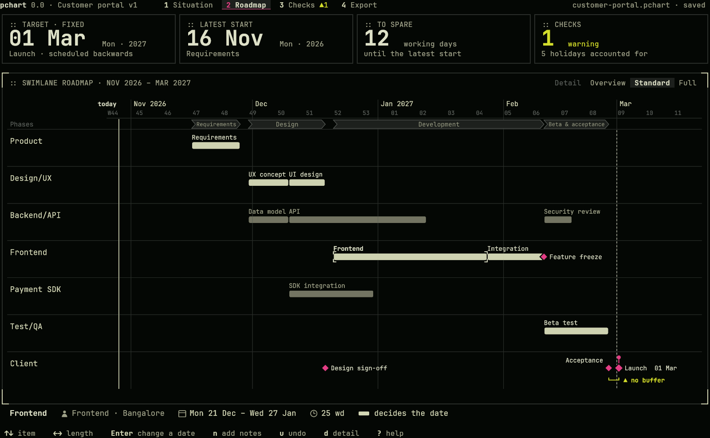
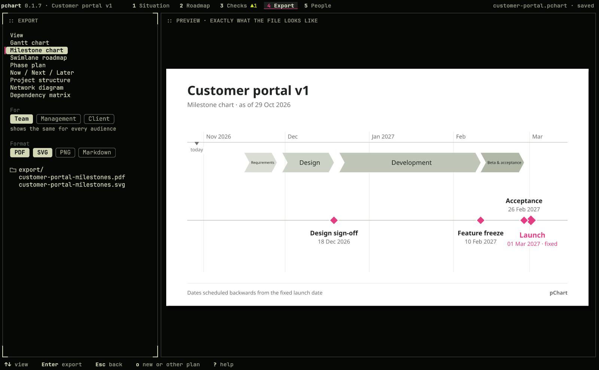

# pChart

Project charts in the terminal that check themselves.

Pick a template, set the target date, and pChart schedules the rest backwards and forwards with holidays per team and place. It shows in plain language whether the date holds, who is waiting on whom and what is due next, and exports the same picture as PDF, SVG, PNG and Markdown. Real graphics in kitty, Ghostty and foot, never ASCII.

**Status:** before the first release, for Arch Linux and Omarchy. The plan is in [docs/PLAN.md](docs/PLAN.md), the approved design in [docs/design](docs/design/).


<p>
  
  
</p>

## Install

On Arch Linux and Omarchy, from this folder:

```sh
sudo pacman -S --needed rust make
make
sudo make install
```

## Start

```sh
pchart
```

pChart offers its templates: ↑↓ picks one, type the target date, and Enter writes the plan to this folder and opens it. `pchart PLAN` opens a plan you have. To look around first, open the sample: `pchart samples/customer-portal.pchart --today 2026-10-29`.

The bar at the bottom shows the keys that work, `?` explains the screen, and Ctrl+P finds any action by typing what you want. `man pchart` describes everything.

## On the command line

```sh
pchart situation PLAN               # does the date hold, who waits on whom, what is next
pchart check PLAN                   # problems and warnings
pchart export PLAN --pdf plan.pdf   # the roadmap as a file; --view gantt, milestones, …
pchart help                         # every command; --json for programs and agents
```

## Terminals

kitty, Ghostty and foot. Terminals without kitty graphics or sixel pictures are not supported.

## License

MIT. Bundled fonts under the SIL Open Font License: JetBrains Mono (`crates/pchart-draw/assets/OFL-JetBrainsMono.txt`) and Noto Sans (`crates/pchart-draw/assets/OFL-NotoSans.txt`). Holiday data comes from [python-holidays](https://github.com/vacanza/holidays) (MIT); see [data/README.md](data/README.md).
